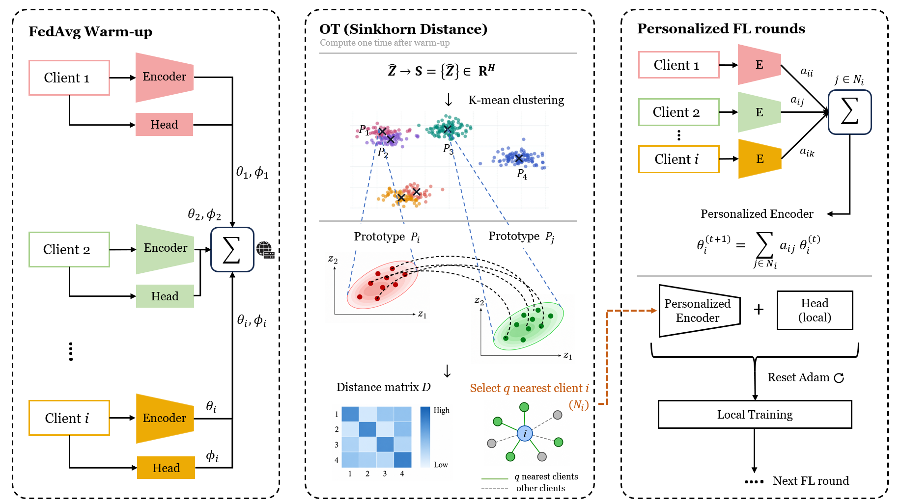

<div align="center">


### Personalized Federated Learning via Similarity-Based Encoder Aggregation for PV Power Forecasting

**S**parse **P**rototype **O**ptimal **T**ransport for Personalized **Fed**erated **PV** Power Forecasting

[](#)
[](#-code-release)
[](https://huggingface.co/datasets/phananh1910/NSRDB-PVlib)

</div>

---

> [!IMPORTANT]
> 🚧 **Code coming soon.** The training code, baselines, and evaluation scripts are being cleaned up and will be released in this repository. Star ⭐ or watch 👀 the repo to be notified when the release is available.

## 📰 News

- **[Coming soon]** Release of the full code base and pretrained models.
- **[2026]** The NSRDB-PVlib dataset (56 PV sites) is available on [Hugging Face](https://huggingface.co/datasets/phananh1910/NSRDB-PVlib).

## 📖 Overview

Accurate short-term photovoltaic (PV) power forecasting is essential for reliable energy management, yet PV data are often distributed across geographically separated sites that cannot share raw measurements. Federated learning (FL) enables collaborative training without exchanging data, but standard methods such as FedAvg struggle under the strong non-IID conditions of PV fleets.

**Fed SPOT-PV** is a personalized FL framework that decides *who should collaborate* from the similarity of local data distributions:

1. **Federated warm-up.** A short FedAvg phase gives all clients a common latent space.
2. **Sparse prototypes.** Each client summarizes its data as a small set of weighted prototypes in that latent space, and only these prototypes are sent to the server.
3. **OT-based similarity.** The server measures inter-client similarity with the debiased Sinkhorn divergence and selects the $q$ nearest neighbours of each client.
4. **Personalized aggregation.** Each client's encoder is aggregated only from its neighbours with similarity weights, while its prediction head stays local.

<p align="center">
  
</p>

## 📊 Main Results

Mean over 5 seeds with the LSTM backbone. Best results are in **bold**.

| Method | NSRDB R² ↑ | NSRDB RMSE ↓ | NSRDB MAE ↓ | PVOD R² ↑ | PVOD RMSE ↓ | PVOD MAE ↓ |
|:--|:--:|:--:|:--:|:--:|:--:|:--:|
| FedAvg | 0.8003 | 0.0903 | 0.0447 | 0.7852 | 0.1160 | 0.0640 |
| FedProx | 0.7898 | 0.0913 | 0.0459 | 0.7476 | 0.1283 | 0.0787 |
| FedNova | 0.8017 | 0.0899 | 0.0448 | 0.7796 | 0.1160 | 0.0636 |
| FedRep | 0.8935 | 0.0654 | 0.0340 | **0.8353** | 0.1065 | 0.0581 |
| Ditto | 0.8928 | 0.0660 | 0.0333 | 0.8043 | 0.1148 | 0.0622 |
| Cluster FL | 0.8962 | 0.0648 | 0.0295 | 0.8093 | 0.1138 | 0.0620 |
| **Fed SPOT-PV (Ours)** | **0.9121** | **0.0603** | **0.0291** | 0.8338 | **0.1055** | **0.0570** |

Fed SPOT-PV achieves the best result in 11 of 12 dataset–backbone–metric settings (LSTM and Informer), while keeping the per-round training cost of FedAvg.

## 🗂️ Datasets

| Dataset | Clients | Resolution | Target | Link |
|:--|:--:|:--:|:--|:--|
| NSRDB-PVlib | 56 sites | 30 min | AC power simulated with `pvlib` | [Hugging Face](https://huggingface.co/datasets/phananh1910/NSRDB-PVlib) |
| PVOD | 10 stations | 15 min | Measured PV power | Original PVOD release |

## 🛠️ Code Release

The following components are planned for release:

- [ ] Fed SPOT-PV implementation (warm-up, prototype construction, Sinkhorn similarity, personalized aggregation)
- [ ] Baselines: FedAvg, FedProx, FedNova, FedRep, Ditto, Cluster FL
- [ ] LSTM and Informer backbones
- [ ] Data preprocessing scripts for NSRDB-PVlib and PVOD
- [ ] Training and evaluation scripts, including statistical tests
- [ ] Configuration files to reproduce all tables and figures

## 📝 Citation

If you find this work useful, please consider citing it. The full reference will be updated once the paper is publicly available.

```bibtex
@article{phan2026fedspotpv,
  title   = {Personalized Federated Learning via Similarity-Based Encoder Aggregation for PV Power Forecasting},
  author  = {Phan, Nguyen Phan Anh},
  journal = {Preprint},
  year    = {2026}
}
```

## 🙏 Acknowledgments

This work is derived from the first author's bachelor thesis at the University of Science and Technology of Hanoi (USTH). We thank the Department of Technology and Engineering, USTH, for its support.

## 📬 Contact

For questions, please open an [issue](https://github.com/alpha19102004/fed-spotpv/issues) in this repository.
